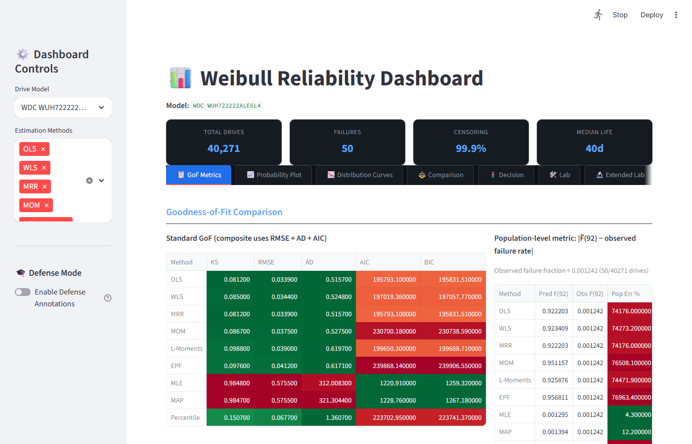

# Weibull Parameter Estimation on Hard Drive Failure Data

[](https://www.r-project.org/)
[](https://www.python.org/)
[](https://streamlit.io/)
[](LICENSE)

Comparative statistical reliability analysis and interactive Streamlit dashboard benchmarking 9 Weibull parameter estimation methods on 117,918 hard drives from the Backblaze Q3 2025 dataset (92-day observational window).

## Key Reliability Findings

Across 117,918 hard drives monitored over 92 days, only 251 drives failed (99.69% to 99.88% right-censoring rate across the 3 dominant drive models: TOSHIBA MG07ACA14TA, TOSHIBA MG08ACA16TA, and WDC WUH722222ALE6L4).

1. **Failure-Only Methods Discarding Censored Drives**:
   - Classical methods that ignore right-censored drives (OLS, WLS, MOM, L-Moments, EPF, Percentile) estimate a scale parameter $\lambda \approx 50\text{--}59\text{ days}$.
   - This result is mathematically misleading: predicting a characteristic life of 50-60 days for a fleet where over 99.7% of drives survived the full 92-day window occurs because the algorithms fit only the ~250 failed units.
2. **Censoring-Aware Methods (MLE and Bayesian MCMC)**:
   - Maximum Likelihood Estimation accounting for right-censoring and Bayesian MCMC (via `brms`/Stan) incorporate the full survival history of non-failed drives.
   - MLE and MCMC consistently agree: shape parameter $k \approx 1.0\text{--}1.3$ (indicating a roughly constant hazard rate during early-to-mid service) and realistic fleet characteristic lifetimes $\lambda \approx 11,800\text{--}43,000\text{ days}$ (32 to 118 years).
   - MCMC 95% posterior credible intervals for $k$ include or closely bound 1.0.
3. **Goodness-of-Fit Paradox**:
   - Standard residual metrics (RMSE, Kolmogorov-Smirnov) evaluated only on observed failure timestamps paradoxically rank the failure-only methods best.
   - Information criteria (AIC, BIC) correctly penalize models that cannot account for fleet-wide survival probabilities.

## Estimation Methods Benchmarked

| Method | Implementation | Censoring Handling |
|---|---|---|
| **OLS** | Ordinary Least Squares on Weibull probability paper | Discards censored drives |
| **WLS** | Weighted Least Squares (variance-weighted) | Discards censored drives |
| **MOM** | Method of Moments ($E[X], \text{Var}(X)$) | Discards censored drives |
| **L-Moments** | Linear combinations of order statistics | Discards censored drives |
| **EPF** | Empirical Probability Function | Discards censored drives |
| **Percentile** | Two-point percentile matching ($t_{0.10}, t_{0.90}$) | Discards censored drives |
| **MLE** | Maximum Likelihood with log-likelihood survival term | Right-censoring aware |
| **MAP** | Maximum A Posteriori (Lognormal informative prior) | Right-censoring aware (prior-sensitive) |
| **MCMC** | Full Bayesian Hamiltonian Monte Carlo (brms / Stan) | Right-censoring aware |

## Repository Structure

```
weibull-parameter-estimation/
├── .gitignore
├── LICENSE
├── README.md
├── packages.R
├── requirements.txt
├── R/
│   ├── 01_data_prep.R
│   ├── 02_estimation_methods.R
│   ├── 03_gof_metrics.R
│   ├── 04_plots.R
│   ├── BLACK_BOX_VS_WHITE_BOX.Rmd
│   └── results/
│       ├── brms_fit_*.rds
│       ├── gof_metrics.csv
│       ├── parameters.csv
│       ├── sensitivity_analysis.csv
│       ├── plots/
│       └── plots_combined/
├── data/
│   ├── README_data.md
│   ├── drives_clean.csv
│   └── model_summary.csv
├── data_exploration/
│   ├── figure3_1.png
│   ├── figure3_2.png
│   ├── figure3_3.png
│   └── generate_figures.py
└── python/
    └── dashboard.py
```

## Running the Project

### Interactive Dashboard (Python / Streamlit)

The Streamlit dashboard executes all parameter estimations directly in Python via SciPy and NumPy, loading from the shipped dataset `data/drives_clean.csv`:

```bash
pip install -r requirements.txt
streamlit run python/dashboard.py
```

### Full R Analysis Pipeline

To run the complete statistical estimation and Bayesian Stan sampling:

```bash
Rscript packages.R
Rscript R/01_data_prep.R
Rscript R/02_estimation_methods.R
Rscript R/03_gof_metrics.R
Rscript R/04_plots.R
```

## Dashboard Preview



## License

This project is licensed under the MIT License - see the [LICENSE](LICENSE) file for details.

